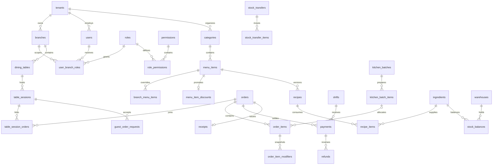

# KTP Table — แผนออกแบบฐานข้อมูล

เวอร์ชัน 1.0 · วันที่ 24 ตุลาคม 2026

เอกสารสำหรับใช้สร้างฐานข้อมูลและ migrations ในภายหลัง อ้างอิงฟังก์ชันของ KTP Table ปัจจุบัน: POS, โต๊ะ, QR สั่งอาหาร, ครัว, ส่วนลดเมนู/บิล, ชำระเงินจำลอง, รายงาน, สต๊อก และหลายสาขา

**สถานะ:** เป็นข้อเสนอสำหรับฐานข้อมูลเป้าหมาย ยังไม่ได้สร้างตารางหรือเปลี่ยนการเก็บข้อมูลของแอป ปัจจุบันยังใช้ `.data/demo.json` ตามเดิม ตารางและฟิลด์ที่เพิ่มจาก Demo ระบุไว้เพื่อใช้พัฒนาต่อ ไม่ได้หมายความว่ามีฟังก์ชันนั้นแล้ว

## 1. ขอบเขตและหลักการ

- ฐานข้อมูลเป้าหมาย: MySQL 8.x, InnoDB, `utf8mb4` โดยกำหนดรุ่นและ collation เดียวกันก่อนเริ่มเขียน migrations
- `tenant` หมายถึงธุรกิจ/เจ้าของข้อมูลหนึ่งราย; `branch` หมายถึงสาขาภายใน tenant ร้านคนละ tenant ต้องไม่เข้าถึงข้อมูลกัน
- Small ใช้ POS/เมนู/บิล/รับเงิน/รายงาน/สิทธิ์/กะ; Medium เพิ่มโต๊ะ/QR/ครัว/สต๊อก; Enterprise เพิ่มหลายสาขา/ราคาสาขา/สูตร/การโอน
- แพ็กเกจเป็นตัวกำหนดการเปิดฟีเจอร์ ไม่ควรสร้างฐานข้อมูลคนละโครงสร้างตามแพ็กเกจ
- แยกราคาปัจจุบันของเมนูออกจากราคาในบิล บิลและใบเสร็จเก็บ snapshot เพื่อไม่ให้ย้อนหลังเปลี่ยนตามการแก้เมนู
- แยกสถานะการทำอาหารออกจากการชำระเงิน การจ่ายเงินไม่ควรทำให้รายการที่ครัวยังทำไม่เสร็จหายจาก KDS
- ส่วนลดเมนูหักเฉพาะราคาอาหาร ไม่รวมตัวเลือกเสริม แล้วจึงคิดส่วนลดบิล ค่าบริการ และ VAT
- ธุรกรรมขาย/รับเงิน/ตัดสต๊อก/โอนสินค้า/แยกบิลต้องใช้ database transaction รองรับการทำงานหลาย process

## 2. มาตรฐานฟิลด์ร่วม

| รายการ | รูปแบบที่กำหนด |
| --- | --- |
| Primary key | `id CHAR(36)` ใช้ UUID ที่แอปสร้าง; ฟิลด์ที่อ้างถึงกันต้องใช้ชนิด/ความยาว/collation เดียวกัน |
| เจ้าของข้อมูล | `tenant_id CHAR(36) NOT NULL` ในตารางข้อมูลธุรกิจทุกตาราง |
| ขอบเขตสาขา | `branch_id CHAR(36) NOT NULL` สำหรับข้อมูลที่เกิดในสาขา; ตารางกลางระดับร้านไม่ต้องมี |
| เวลา | `created_at`, `updated_at` เป็น `DATETIME(3)` เก็บ UTC; แสดงผล Asia/Bangkok |
| วันที่ธุรกิจ | `business_date DATE` ตามวันทำการของสาขา แยกจาก UTC timestamp และต้องกำหนดนโยบายกะข้ามวัน |
| ผู้ดำเนินการ | `created_by_user_id`, `updated_by_user_id` nullable ตามกรณี เช่น ออเดอร์จากลูกค้าไม่มี user พนักงาน |
| จำนวนเงิน | `DECIMAL(14,2)` หน่วยบาท ห้ามใช้ FLOAT/DOUBLE |
| อัตราเปอร์เซ็นต์ | `DECIMAL(5,2)` พร้อม validation ตามชนิด เช่น ส่วนลด 0–100, VAT/service ตามนโยบายร้าน |
| จำนวนอาหาร | `INT` มากกว่า 0 สำหรับการเพิ่มรายการ; การยกเลิกเก็บแยก ไม่ใช้จำนวนติดลบในบิล |
| จำนวนวัตถุดิบ | `DECIMAL(18,6)` เพื่อรองรับการแปลงหน่วยและสูตร |
| จำนวนเงินติดลบ | อนุญาตเฉพาะฟิลด์ที่กำหนด เช่น rounding adjustment; refund ใช้จำนวนบวกและแยกประเภท |
| สกุลเงิน | `currency CHAR(3)` ค่าเริ่มต้น `THB`; บิลหนึ่งใบใช้สกุลเงินเดียว |
| ลบข้อมูล | เมนู/ผู้ใช้/โต๊ะใช้ `is_active` หรือ `deleted_at`; บิล การเงิน และ audit ไม่ลบจริงจากหน้าจอทั่วไป |
| ข้อมูลเสริม | JSON ใช้กับ snapshot/metadata ที่ไม่ต้อง join หลัก ไม่ใช้แทน FK, ยอดเงิน หรือรายละเอียดรายการทั้งหมด |

ตารางย่อยที่ซ้ำขอบเขต tenant/branch จากตารางแม่ต้องใช้ composite FK เพื่อบังคับว่าขอบเขตตรงกัน ไม่ใช่กรอง tenant เฉพาะที่ API

ตัวอย่าง: `orders` มี unique `(tenant_id, branch_id, id)` และ `order_items` อ้าง `(tenant_id, branch_id, order_id)` ไปยัง key นี้ ทุก FK ควรมี index รองรับ หลีกเลี่ยง cascade delete บนข้อมูลการเงินและประวัติ

## 3. ภาพรวมความสัมพันธ์



แผนภาพแสดงความสัมพันธ์หลัก ไม่ได้แสดง FK ทุกคอลัมน์

## 4. ร้าน สาขา และการตั้งค่า

### 4.1 `tenants` — ธุรกิจ/เจ้าของข้อมูล

| ฟิลด์ | ชนิด | หน้าที่ |
| --- | --- | --- |
| id | CHAR(36), PK | รหัส tenant |
| code | VARCHAR(50) | รหัสธุรกิจ ไม่ซ้ำทั้งระบบ |
| name | VARCHAR(150) | ชื่อธุรกิจ เช่น KTP Table |
| plan | VARCHAR(20) | small / medium / enterprise |
| status | VARCHAR(20) | active / suspended / archived |

เพิ่มเวลาสร้าง/แก้ไขตามมาตรฐานร่วม; unique `code`

### 4.2 `tenant_settings` — การตั้งค่าระดับร้าน

`tenant_id` เป็น PK/FK; ฟิลด์หลัก `currency CHAR(3)`, `timezone VARCHAR(50)`, `tax_rate DECIMAL(5,2)`, `service_rate DECIMAL(5,2)`, `price_tax_mode VARCHAR(20)`, `stock_deduction_policy VARCHAR(30)`, `qr_session_ttl_minutes INT`, `business_day_cutoff TIME`

กำหนด `price_tax_mode=exclusive` และ `stock_deduction_policy=on_payment` เพื่อให้ตรง Demo ปัจจุบัน QR มีอายุ 720 นาที ค่าเหล่านี้ต้อง snapshot เข้าบิล/รอบโต๊ะตามความเหมาะสม ห้ามอ่านค่าปัจจุบันมาคำนวณบิลเก่าใหม่

### 4.3 `branches` — สาขา

`id`, `tenant_id`, `code VARCHAR(50)`, `name VARCHAR(150)`, `address TEXT NULL`, `phone VARCHAR(30) NULL`, `status VARCHAR(20)`, `daily_sales_target DECIMAL(14,2)`

unique `(tenant_id, code)` และ `(tenant_id, id)`; สาขาไม่ย้ายข้าม tenant หลังมีธุรกรรม

## 5. ผู้ใช้ สิทธิ์ และ session พนักงาน

### 5.1 `users`

`id`, `tenant_id`, `name VARCHAR(150)`, `username VARCHAR(100)`, `email VARCHAR(255) NULL`, `password_hash VARCHAR(255)`, `pin_hash VARCHAR(255) NULL`, `is_active BOOLEAN`, `last_login_at DATETIME(3) NULL`, `deleted_at DATETIME(3) NULL`

unique `(tenant_id, username)`; หากใช้ email เป็นชื่อเข้าระบบให้กำหนด unique `(tenant_id, email)` และนโยบาย normalize email ห้ามเก็บรหัสผ่าน/PIN เป็นข้อความตรง ๆ และไม่คืน hash ผ่าน API

### 5.2 `roles`

`id`, `tenant_id`, `code VARCHAR(50)`, `name_th VARCHAR(100)`, `is_system BOOLEAN`

unique `(tenant_id, code)`; ใช้รหัสภายในคงเดิมและชื่อแสดงภาษาไทย:

| code | name_th |
| --- | --- |
| Owner | เจ้าของร้าน |
| Manager | ผู้จัดการร้าน |
| Cashier | แคชเชียร์ |
| Waiter | พนักงานเสิร์ฟ |
| Kitchen | พนักงานครัว |
| HQ Admin | ผู้ดูแลสำนักงานใหญ่ |

`Customer` ไม่ใช่บัญชีพนักงาน ลูกค้า QR ใช้สิทธิ์เฉพาะรอบโต๊ะ ไม่ควรสร้าง user พนักงานปลอมให้ทุก QR

### 5.3 `permissions` และ `role_permissions`

- `permissions`: `id`, `code VARCHAR(100) UNIQUE`, `name_th VARCHAR(150)` เป็นทะเบียนสิทธิ์กลาง ไม่มีข้อมูลลูกค้าหรือร้าน
- `role_permissions`: `tenant_id`, `role_id`, `permission_id`; PK/unique `(tenant_id, role_id, permission_id)`
- ตัวอย่าง permission: `orders.create`, `orders.pay`, `orders.cancel`, `orders.discount`, `orders.refund`, `tables.manage`, `kitchen.update`, `catalog.manage`, `inventory.adjust`, `reports.read`, `users.manage`, `hq.manage`
- API ต้องตรวจทั้ง permission, แพ็กเกจ, tenant และสิทธิ์สาขา ไม่ใช้แค่การซ่อนปุ่ม

### 5.4 `user_branch_roles`

`id`, `tenant_id`, `user_id`, `role_id`, `branch_id CHAR(36) NULL`, `scope_type VARCHAR(20)`

`scope_type=branch` ต้องมี branch_id; `scope_type=tenant` ต้องไม่มี branch_id และต้องเป็นบทบาทที่ได้รับสิทธิ์บริหารข้ามสาขา ห้ามถือว่า Manager เข้าทุกสาขาได้โดยอัตโนมัติหากยังไม่ได้มอบหมาย scope

ป้องกันการมอบหมายซ้ำด้วย unique key ที่ normalize branch_id ว่างเป็น scope ระดับ tenant หรือแยก unique generated column โดยตรวจรายละเอียดตอนทำ migrations

### 5.5 `user_sessions`

`id`, `tenant_id`, `user_id`, `token_hash BINARY(32)`, `expires_at DATETIME(3)`, `revoked_at DATETIME(3) NULL`, `last_seen_at DATETIME(3)`, `ip_address VARCHAR(45) NULL`, `user_agent VARCHAR(500) NULL`

unique `token_hash`; index `(user_id, revoked_at, expires_at)`; เก็บเฉพาะ hash ของ token สำหรับตรวจ session และเพิกถอนได้หลังเปลี่ยนสิทธิ์/ปิดบัญชี

## 6. เมนู ตัวเลือก ราคา และส่วนลด

### 6.1 `categories`

`id`, `tenant_id`, `code VARCHAR(50)`, `name_th VARCHAR(100)`, `name_en VARCHAR(100) NULL`, `icon VARCHAR(50) NULL`, `sort_order INT`, `is_active BOOLEAN`

unique `(tenant_id, code)`; หมวด “ทั้งหมด” เป็นตัวกรองใน UI ไม่ต้องสร้างเป็น category ในฐานข้อมูล

### 6.2 `menu_items`

`id`, `tenant_id`, `category_id`, `sku VARCHAR(80) NULL`, `name_th VARCHAR(150)`, `name_en VARCHAR(150) NULL`, `description TEXT NULL`, `image_url VARCHAR(1000) NULL`, `base_price DECIMAL(14,2)`, `is_available BOOLEAN`, `is_popular BOOLEAN`, `is_active BOOLEAN`, `deleted_at DATETIME(3) NULL`

FK category ต้องอยู่ tenant เดียวกัน; base_price ต้องไม่ติดลบ; index `(tenant_id, category_id, is_active, is_available)`

### 6.3 `branch_menu_items` — ราคา/สถานะเฉพาะสาขา

`id`, `tenant_id`, `branch_id`, `menu_item_id`, `price_override DECIMAL(14,2) NULL`, `is_available_override BOOLEAN NULL`

unique `(tenant_id, branch_id, menu_item_id)`; NULL หมายถึงใช้ค่ากลาง ส่วนค่า 0 เป็นราคาที่กำหนดจริง ต้องไม่ตีความเป็นไม่มี override

Demo ปัจจุบันมีราคา override ต่อสาขา; สถานะพร้อมขายเฉพาะสาขาเป็นข้อเสนอเพิ่มสำหรับฐานข้อมูลเป้าหมาย

### 6.4 `modifier_groups`, `modifier_options`, `menu_item_modifier_groups`

| ตาราง | ฟิลด์หลัก |
| --- | --- |
| modifier_groups | id, tenant_id, name VARCHAR(100), selection_type VARCHAR(20), min_select INT, max_select INT, is_active |
| modifier_options | id, tenant_id, modifier_group_id, name VARCHAR(100), additional_price DECIMAL(14,2), sort_order INT, is_active |
| menu_item_modifier_groups | tenant_id, menu_item_id, modifier_group_id, sort_order INT |

unique การผูก `(tenant_id, menu_item_id, modifier_group_id)`; option ต้องอยู่ group และ tenant เดียวกัน; additional_price ไม่ติดลบ สำหรับพฤติกรรมเดิมให้ใช้ single-select ครั้งละหนึ่งรายการต่อกลุ่ม

### 6.5 `menu_item_discounts`

`id`, `tenant_id`, `menu_item_id`, `discount_type VARCHAR(20)`, `discount_value DECIMAL(14,2)`, `updated_by_user_id`

unique `(tenant_id, menu_item_id)`; ส่วนลดกลางต่อเมนูหนึ่งรายการ ไม่มี branch_id ตามฟังก์ชันปัจจุบัน

| discount_type | ข้อกำหนด |
| --- | --- |
| none | discount_value = 0 |
| percent | discount_value 0–100 ทศนิยมสองตำแหน่ง |
| fixed | discount_value 0–100000 บาทต่อจาน; หักจริงสูงสุดเท่าราคาพื้นฐานของสาขา |

ต้องบังคับเงื่อนไขทั้ง API และ database constraint ที่ใช้ได้ในรุ่น MySQL เป้าหมาย ถ้าจะมีวันเริ่ม/หมดอายุหรือโปรโมชั่นหลายรายการซ้อนกันในอนาคต ให้เพิ่มโมดูล promotions พร้อมกติกาเลือกโปรโมชั่นก่อน ไม่เพิ่มการซ้อนส่วนลดโดยปริยาย

## 7. โต๊ะ การจอง และ QR ลูกค้า

### 7.1 `dining_tables`

`id`, `tenant_id`, `branch_id`, `code VARCHAR(30)`, `name VARCHAR(50)`, `seats INT`, `zone VARCHAR(100) NULL`, `is_active BOOLEAN`

unique `(tenant_id, branch_id, code)`; seats > 0; สถานะว่าง/ใช้งาน/จองแสดงจากรอบโต๊ะ บิล และการจอง ไม่เก็บ boolean ซ้ำหลายแห่งจนขัดกัน

### 7.2 `table_reservations`

`id`, `tenant_id`, `branch_id`, `table_id`, `customer_name VARCHAR(150)`, `customer_phone VARCHAR(30) NULL`, `party_size INT`, `reserved_from DATETIME(3)`, `reserved_until DATETIME(3) NULL`, `status VARCHAR(20)`, `note TEXT NULL`, `created_by_user_id`, `cancelled_by_user_id NULL`, `cancel_reason TEXT NULL`

status: reserved / arrived / cancelled / no_show; index `(tenant_id, branch_id, table_id, reserved_from, status)`; ต้องตรวจช่วงเวลาทับกันใน transaction ไม่ใช่ unique ที่เวลาเริ่มอย่างเดียว Demo เดิมมีเพียงชื่อและเวลาจองวันนี้

### 7.3 `table_sessions`

| ฟิลด์ | ชนิด | หน้าที่ |
| --- | --- | --- |
| id | CHAR(36), PK | หนึ่งรอบบริการโต๊ะ |
| tenant_id / branch_id / table_id | CHAR(36) | ขอบเขตที่ Backend ใช้ระบุโต๊ะให้ลูกค้า |
| token_hash | BINARY(32), UNIQUE | Hash ของ QR token สุ่มที่มี entropy สูง |
| token_ciphertext | BLOB NULL | เก็บ token แบบเข้ารหัสเฉพาะเมื่อจำเป็นต้องเปิด QR เดิมเพื่อพิมพ์ซ้ำ; key อยู่นอก DB |
| status | VARCHAR(20) | active / closed / expired / revoked |
| accepting_orders | BOOLEAN | หยุดรับรายการระหว่างแยก/ชำระบิล |
| opened_at / expires_at / closed_at | DATETIME(3) | closed_at ว่างได้ |
| opened_by_user_id / closed_by_user_id | CHAR(36) NULL | ผู้เปิด/ปิด หรือระบบปิดอัตโนมัติ |
| close_reason | VARCHAR(500) NULL | เช่น จ่ายครบ ย้ายโต๊ะ หรือรวมบิล |
| guest_snapshot_json | JSON NULL | ข้อมูลที่อนุญาตให้ลูกค้าอ่านหลังปิดรอบ ไม่อ่านบิลปลายทางที่มีรายการเพิ่มในภายหลัง |

หนึ่งโต๊ะมีรอบ active ได้ไม่เกินหนึ่งรอบ ต้องใช้ constraint รองรับ concurrent requests ด้วย ตัวอย่างแนวทางสำหรับ MySQL:

```sql
-- ตัวอย่างส่วนประกอบ constraint ไม่ใช่ migration พร้อมรัน
active_table_id CHAR(36)
  GENERATED ALWAYS AS (
    CASE WHEN status = 'active' THEN table_id ELSE NULL END
  ) STORED,
UNIQUE KEY uq_active_table (tenant_id, branch_id, active_table_id)
```

ไม่ใส่ `NOW()` ใน generated column ก่อนเปิดรอบใหม่ให้ lock โต๊ะและเปลี่ยนรอบหมดอายุเป็น expired ใน transaction เดียวกัน มี scheduled job เก็บกวาดรอบหมดอายุเพิ่มเติมได้ ตรวจ expires_at ใน API ทุกครั้งแม้ job ยังไม่ทำงาน

ห้ามคืน QR token/hash/ciphertext ให้ผู้ใช้ที่ไม่มีสิทธิ์ และห้ามใช้ token นี้กับ API พนักงาน

### 7.4 `table_session_orders`

`tenant_id`, `branch_id`, `table_session_id`, `order_id`, `linked_at DATETIME(3)`; unique `(tenant_id, table_session_id, order_id)`

แยกเป็นตารางเชื่อมเพื่อให้รอบหนึ่งมีหลายบิลหลังแยกบิล และติดตาม lifecycle ได้ครบ การย้าย/รวมบิลต้องเพิกถอนการสั่งจาก QR ต้นทางตามกติกาปัจจุบัน ไม่ขยายสิทธิ์ลูกค้าไปยังโต๊ะอื่นตาม FK โดยอัตโนมัติ

### 7.5 `guest_order_requests`

`id`, `tenant_id`, `branch_id`, `table_session_id`, `request_key VARCHAR(100)`, `request_hash BINARY(32)`, `status VARCHAR(20)`, `result_order_id`, `result_batch_id`, `response_json JSON NULL`, `completed_at DATETIME(3) NULL`

unique `(tenant_id, table_session_id, request_key)`; บันทึกผลคำขอพร้อมรายการอาหารและรอบครัวใน transaction เดียวกัน

รหัสเดิม+รายการเดิมคืนผลเดิม ไม่เพิ่มรายการ รหัสเดิม+รายการต่างกันตอบ conflict ต้อง normalize modifiers/note/quantity ให้เหมือนกันก่อนคำนวณ hash ไม่รับราคา tenant หรือ table ที่ client ส่งมาเป็นแหล่งจริง

## 8. บิล รายการ และครัว

### 8.1 `orders`

| ฟิลด์ | ชนิด / รายละเอียด |
| --- | --- |
| id, tenant_id, branch_id | รหัสและขอบเขต |
| order_number | VARCHAR(50), unique ภายใน tenant/branch ตามรูปแบบเลขที่เลือก |
| business_date, currency | DATE, CHAR(3) |
| table_id | CHAR(36) NULL สำหรับกลับบ้าน/เดลิเวอรี/บิลแยก |
| shift_id | CHAR(36) NULL; กะรับออเดอร์ แยกจากกะรับเงินใน payments |
| order_type | dinein / takeaway / delivery |
| source | staff / customer_qr |
| status | draft / open / paid / cancelled / merged / split |
| kitchen_status | pending / cooking / ready / served / not_required; ค่าแสดงผลที่สรุปจาก batch |
| created_by_user_id | NULL สำหรับลูกค้า QR |
| created_via_table_session_id | CHAR(36) NULL |
| tax_rate_snapshot, service_rate_snapshot | DECIMAL(5,2) |
| price_tax_mode_snapshot | VARCHAR(20), เริ่มจาก exclusive |
| subtotal | DECIMAL(14,2), ยอดสินค้าหลังลดเมนู ก่อนลดบิล |
| bill_discount_amount, service_amount, tax_amount | DECIMAL(14,2) |
| rounding_adjustment | DECIMAL(14,2), บวก/ลบได้ |
| grand_total, paid_total, refunded_total | DECIMAL(14,2); ค่ารวมที่ต้องอัปเดตใน transaction |
| paid_at, closed_at | DATETIME(3) NULL |
| cancelled_by_user_id, cancel_reason | NULL เมื่อไม่ยกเลิก |
| version | BIGINT, ใช้ตรวจ concurrent edit ได้ |

การแยก status การเงิน/บิลจาก kitchen_status เป็นโครงสร้างเป้าหมาย Demo ปัจจุบันใช้ `status` เดียวร่วมกัน ต้องปรับ API/ตัวแปลงสถานะตอนย้ายฐานข้อมูล ไม่เปลี่ยน enum แล้วนำข้อมูลเดิมเข้าโดยตรง

index หลัก `(tenant_id, branch_id, status, created_at)`, `(tenant_id, branch_id, business_date, paid_at)`, `(tenant_id, branch_id, table_id, status)`

### 8.2 `order_items`

| ฟิลด์ | ชนิด / รายละเอียด |
| --- | --- |
| id, tenant_id, branch_id, order_id | รหัสรายการและบิล |
| menu_item_id | CHAR(36) NULL ได้เมื่อเมนูถูก archive; ไม่ลบ snapshot |
| kitchen_batch_item_id | CHAR(36) NULL; เชื่อมรายการเตรียมอาหารเมื่อส่งครัว |
| menu_name_snapshot, category_name_snapshot | VARCHAR(150) |
| category_id_snapshot | CHAR(36) NULL สำหรับรายงานหมวดเดิม |
| quantity, cancelled_quantity | INT; ยอดยกเลิกต้องไม่เกิน quantity |
| base_unit_price | DECIMAL(14,2), ราคาอาหารหลัง branch override แต่ก่อนลดเมนู |
| modifier_unit_total | DECIMAL(14,2), ยอดตัวเลือกเสริมต่อจาน |
| original_unit_price | DECIMAL(14,2), base + modifier ก่อนลดเมนู |
| menu_discount_type_snapshot | none / percent / fixed |
| menu_discount_value_snapshot | DECIMAL(14,2), ค่าที่ตั้งโปรโมชั่นตอนรับรายการ |
| menu_discount_unit_amount | DECIMAL(14,2), ยอดที่ลดจริงต่อจาน |
| net_unit_price | DECIMAL(14,2), ราคาหลังลดเมนูรวมตัวเลือกเสริม |
| line_total | DECIMAL(14,2), net_unit_price × จำนวนที่ยังไม่ยกเลิก |
| note | VARCHAR(500) NULL |
| status | active / cancelled / moved |
| origin_order_item_id | CHAR(36) NULL, อ้างรายการต้นทางเมื่อแยก/รวมบิล |
| recipe_id_snapshot | CHAR(36) NULL, สูตร revision ที่ใช้กับรายการนี้ |

`net_unit_price` ตรงกับ `unitPrice` ใน Demo ส่วน `menu_discount_unit_amount` ตรงกับ `menuDiscount` ห้ามนำส่วนลดนี้ไปหัก subtotal ซ้ำ

### 8.3 `order_item_modifiers`

`id`, `tenant_id`, `branch_id`, `order_item_id`, `modifier_group_id NULL`, `modifier_option_id NULL`, `group_name_snapshot VARCHAR(100)`, `option_name_snapshot VARCHAR(100)`, `additional_unit_price DECIMAL(14,2)`

Snapshot ต้องอยู่ต่อแม้แก้/ปิดตัวเลือกปัจจุบัน การตรวจ option อยู่ใน group/เมนูที่อนุญาตทำตอนรับออเดอร์

### 8.4 `kitchen_batches` และ `kitchen_batch_items`

| ตาราง | ฟิลด์หลัก |
| --- | --- |
| kitchen_batches | id, tenant_id, branch_id, table_session_id NULL, originating_order_id, round_number INT, source, status, sent_at, started_at NULL, ready_at NULL, served_at NULL, cancelled_at NULL, updated_by_user_id NULL |
| kitchen_batch_items | id, tenant_id, branch_id, kitchen_batch_id, menu_item_id NULL, menu_name_snapshot, modifiers_snapshot_json, note, quantity INT, cancelled_quantity INT, status, recipe_id_snapshot NULL |

unique `(tenant_id, originating_order_id, round_number)`; index `(tenant_id, branch_id, status, sent_at)`

ครัวทำงานกับรายการเตรียมอาหารจริง ไม่ใช่การแบ่งเงิน: `order_items` หลายรายการหลังแยกบิลสามารถอ้าง kitchen_batch_item เดียวกันได้ การแยก/รวมบิลจึงไม่สร้างอาหารเข้าครัวซ้ำ ต้องรักษาผลรวมจำนวนที่จัดสรรให้ตรงกับจำนวนที่สั่งจริง

KDS อ่านสถานะ batch โดยตรง แม้บิลชำระเงินแล้ว หากร้านอนุญาตให้จ่ายก่อนอาหารเสร็จ อาหารต้องยังอยู่ในคิวจนเสิร์ฟ/ยกเลิก

### 8.5 `order_item_cancellations`

`id`, `tenant_id`, `branch_id`, `order_id`, `order_item_id`, `cancelled_quantity INT`, `reason TEXT`, `actor_user_id`, `cancelled_at DATETIME(3)`, `kitchen_batch_item_id NULL`

ระบุเหตุผลและผู้มีสิทธิ์ทุกครั้ง อัปเดตทั้งยอดบิลและสถานะครัวใน transaction เดียวกัน ไม่ลบแถว order item ทิ้งเพื่อเก็บหลักฐานย้อนหลัง

### 8.6 `order_adjustments`

`id`, `tenant_id`, `branch_id`, `order_id`, `adjustment_type VARCHAR(30)`, `amount DECIMAL(14,2)`, `reason TEXT NULL`, `approved_by_user_id`, `created_at`

เริ่มจาก `bill_discount` ซึ่งเป็นส่วนลดเงินบาทตาม Demo ไม่รวมส่วนลดรายเมนูที่ snapshot อยู่ใน order_items ถ้ารองรับการแก้ส่วนลดหลายครั้งให้กำหนดแถวปัจจุบัน/ยกเลิกแถวเก่าอย่างชัดเจน และให้ยอดรวมตรงกับ orders.bill_discount_amount

### 8.7 `order_events`

`id`, `tenant_id`, `branch_id`, `order_id`, `event_type VARCHAR(50)`, `related_order_id NULL`, `actor_user_id NULL`, `table_session_id NULL`, `reason TEXT NULL`, `metadata_json JSON NULL`, `created_at`

เก็บประวัติเปิดบิล เพิ่มรายการ ย้ายโต๊ะ แยก/รวมบิล และสถานะ เช่น `split_from`, `merged_into` เพื่อเชื่อมบิลต้นทาง/ปลายทางโดยไม่เดาจากเลขบิล

## 9. การรับเงิน ใบเสร็จ คืนเงิน และกะ

### 9.1 `payments`

`id`, `tenant_id`, `branch_id`, `order_id`, `shift_id`, `idempotency_key VARCHAR(100)`, `request_hash BINARY(32)`, `method VARCHAR(20)`, `status VARCHAR(20)`, `amount DECIMAL(14,2)`, `cash_received DECIMAL(14,2) NULL`, `cash_change DECIMAL(14,2) NULL`, `currency CHAR(3)`, `is_simulated BOOLEAN`, `paid_at DATETIME(3) NULL`, `received_by_user_id`, `provider_reference VARCHAR(150) NULL`

unique `(tenant_id, order_id, idempotency_key)`; idempotency ต้องตรวจ payload ด้วย ไม่ใช้รหัสเดิมกับยอด/วิธีชำระอื่น ตัวเลขเงินทอนเก็บแยกจาก amount ที่รับรู้เป็นยอดขาย

ปัจจุบันรับเต็มบิลหนึ่งครั้ง ให้ lock order และตรวจ outstanding amount ก่อนสร้าง successful payment ทุกครั้ง หากภายหลังต้องชำระหลายวิธีในบิลเดียว ให้เพิ่มกติกาผลรวมสำเร็จไม่เกินยอดค้างก่อนเปิดฟีเจอร์

### 9.2 `receipts`

`id`, `tenant_id`, `branch_id`, `order_id`, `receipt_number VARCHAR(50)`, `issued_at DATETIME(3)`, `issued_by_user_id`, `receipt_snapshot_json JSON`, `is_simulated BOOLEAN`, `voided_at DATETIME(3) NULL`, `void_reason TEXT NULL`

unique `(tenant_id, branch_id, receipt_number)` และ `(tenant_id, order_id)` สำหรับใบเสร็จหลักหนึ่งใบต่อบิล Snapshot มีชื่อร้าน/สาขา รายการราคา ส่วนลด ภาษี ค่าบริการ และยอดชำระ ณ เวลาออกเอกสาร แก้เมนูหรือชื่อร้านภายหลังไม่เปลี่ยนใบเสร็จเก่า

### 9.3 `refunds`

`id`, `tenant_id`, `branch_id`, `order_id`, `payment_id`, `idempotency_key VARCHAR(100)`, `amount DECIMAL(14,2)`, `reason TEXT`, `status VARCHAR(20)`, `approved_by_user_id`, `refunded_by_user_id`, `refunded_at DATETIME(3) NULL`, `is_simulated BOOLEAN`, `provider_reference VARCHAR(150) NULL`

unique `(tenant_id, payment_id, idempotency_key)`; ผลรวมยอดคืนสำเร็จต้องไม่เกินยอดจ่ายจริง ปัจจุบันคืนเต็มบิลครั้งเดียว ยังไม่ต้องมี refund_items จนกว่าจะพัฒนาคืนเงินบางส่วน

### 9.4 `shifts`

`id`, `tenant_id`, `branch_id`, `terminal_code VARCHAR(50)`, `business_date DATE`, `status VARCHAR(20)`, `opening_cash DECIMAL(14,2)`, `expected_cash DECIMAL(14,2) NULL`, `counted_cash DECIMAL(14,2) NULL`, `cash_difference DECIMAL(14,2) NULL`, `opened_by_user_id`, `closed_by_user_id NULL`, `opened_at`, `closed_at NULL`, `note TEXT NULL`

กำหนดได้ว่าหนึ่งสาขามีกะพร้อมกันหนึ่งกะ หรือหนึ่งกะต่อ terminal สำหรับระยะแรกใช้ terminal เดียวและ unique active shift ต่อสาขา/terminal ด้วยแนวทาง generated column แบบเดียวกับ active table session

## 10. สูตร วัตถุดิบ คลัง และการโอน

### 10.1 `ingredients`

`id`, `tenant_id`, `sku VARCHAR(80)`, `name VARCHAR(150)`, `base_unit VARCHAR(30)`, `is_active BOOLEAN`, `deleted_at NULL`

unique `(tenant_id, sku)`; ระบุหน่วยมาตรฐานชัดเจน เช่น กก./ลิตร/ฟอง ไม่ใช้ชื่ออย่างเดียวเป็นรหัสเชื่อมวัตถุดิบระหว่างสาขา หากจะรองรับรับเข้าเป็นแพ็กและใช้เป็นกรัม ให้เพิ่มการแปลงหน่วยที่ตรวจสอบได้ก่อน

### 10.2 `warehouses`

`id`, `tenant_id`, `branch_id NULL`, `code VARCHAR(50)`, `name VARCHAR(150)`, `warehouse_type VARCHAR(20)`, `is_active BOOLEAN`

unique `(tenant_id, code)`; type `branch` ต้องมี branch_id, type `central` ต้องไม่มี branch_id การเข้าคลังกลางต้องใช้สิทธิ์ HQ/Owner ที่กำหนด การมีคลังกลางแยกเป็นข้อเสนอสำหรับต่อยอด Enterprise; Demo เดิมมีเฉพาะ stock รายสาขา

### 10.3 `stock_balances`

`id`, `tenant_id`, `warehouse_id`, `ingredient_id`, `quantity DECIMAL(18,6)`, `minimum_quantity DECIMAL(18,6)`, `version BIGINT`

unique `(tenant_id, warehouse_id, ingredient_id)`; minimum ไม่ติดลบ; การปรับ quantity ต้องมี stock_movements อ้างอิงใน transaction เดียวกัน และไม่อนุญาต stock ติดลบตามกติกาปัจจุบัน

### 10.4 `recipes` และ `recipe_items`

| ตาราง | ฟิลด์หลัก |
| --- | --- |
| recipes | id, tenant_id, menu_item_id, revision INT, yield_quantity DECIMAL(18,6), status VARCHAR(20), published_at NULL |
| recipe_items | id, tenant_id, recipe_id, ingredient_id, quantity DECIMAL(18,6), waste_percent DECIMAL(5,2) DEFAULT 0 |

unique `(tenant_id, menu_item_id, revision)`; สูตรที่ถูกอ้างในรายการขายแล้วไม่แก้ทับ ให้สร้าง revision ใหม่ quantities ต้องใช้หน่วยฐานของ ingredient และคำนวณต่อ yield ให้ชัดเจน

### 10.5 `stock_movements`

`id`, `tenant_id`, `warehouse_id`, `ingredient_id`, `movement_type VARCHAR(30)`, `quantity_delta DECIMAL(18,6)`, `balance_after DECIMAL(18,6)`, `reason TEXT`, `actor_user_id NULL`, `order_item_id NULL`, `payment_id NULL`, `refund_id NULL`, `transfer_item_id NULL`, `operation_key VARCHAR(150)`, `created_at`

unique `(tenant_id, operation_key)`; index `(tenant_id, warehouse_id, ingredient_id, created_at)`; ประเภทเริ่มจาก opening / receive / adjust / sale / refund / transfer_out / transfer_in

อ้างอิงธุรกรรมด้วย FK ไม่ค้นหาว่าเป็นการขาย/คืนรายการใดจากข้อความ reason เมื่อคืน stock ให้อ้าง movement ที่ตัดจริง ไม่อ่านสูตรล่าสุด การคืนเงินไม่จำเป็นต้องหมายถึงอาหารกลับเข้าคลังจริงเสมอ: Demo ปัจจุบันคืน stock อัตโนมัติ แต่ก่อนใช้งานจริงต้องกำหนดนโยบายคืนของ/อาหารที่ทำแล้วและบันทึกการตัดสินใจ

### 10.6 `stock_transfers` และ `stock_transfer_items`

| ตาราง | ฟิลด์หลัก |
| --- | --- |
| stock_transfers | id, tenant_id, transfer_number VARCHAR(50), from_warehouse_id, to_warehouse_id, status VARCHAR(30), requested_by_user_id, approved_by_user_id NULL, requested_at, approved_at NULL, cancelled_at NULL, reason TEXT NULL |
| stock_transfer_items | id, tenant_id, stock_transfer_id, ingredient_id, requested_quantity DECIMAL(18,6), transferred_quantity DECIMAL(18,6) |

unique `(tenant_id, transfer_number)`; ต้นทาง/ปลายทางต้องคนละคลังใน tenant เดียวกัน การขออนุมัติไม่ตัด stock; ตอนอนุมัติตรวจยอดต้นทางใหม่แล้วปรับทั้งสองคลังพร้อม movements ใน transaction เดียวกัน รองรับหลายวัตถุดิบต่อเอกสารได้แม้ Demo เดิมโอนได้ครั้งละหนึ่งวัตถุดิบ

## 11. ประวัติ เลขเอกสาร และ event

### 11.1 `audit_logs`

`id`, `tenant_id`, `branch_id NULL`, `actor_type VARCHAR(20)`, `actor_user_id NULL`, `actor_table_session_id NULL`, `actor_name_snapshot VARCHAR(150)`, `actor_role_snapshot VARCHAR(50) NULL`, `action VARCHAR(100)`, `entity_type VARCHAR(50)`, `entity_id CHAR(36) NULL`, `reason TEXT NULL`, `before_json JSON NULL`, `after_json JSON NULL`, `occurred_at DATETIME(3)`

actor_type: staff / customer / system; index `(tenant_id, branch_id, occurred_at)` และ `(tenant_id, entity_type, entity_id, occurred_at)` ไม่เก็บรหัสผ่าน session token QR token หรือข้อมูลบัตรลง audit ห้ามเปิดสิทธิ์แก้ไขประวัติจาก UI ทั่วไป

### 11.2 `number_sequences`

`tenant_id`, `branch_id`, `document_type VARCHAR(30)`, `period_key VARCHAR(20)`, `next_value BIGINT`

unique `(tenant_id, branch_id, document_type, period_key)` ใช้ row lock เพื่อออกเลข order/receipt/transfer ภายใน transaction ห้ามใช้ `MAX(number)+1` เมื่อหลายเครื่องทำงานพร้อมกัน

### 11.3 `event_outbox` — เตรียมสำหรับ realtime ภายหลัง

`id`, `tenant_id`, `branch_id NULL`, `event_type VARCHAR(100)`, `aggregate_type VARCHAR(50)`, `aggregate_id`, `payload_json JSON`, `created_at`, `published_at NULL`, `attempt_count INT`, `last_error TEXT NULL`

index `(published_at, created_at)`; บันทึก event ใน transaction ของ order แล้วให้ worker ส่ง WebSocket/SSE ภายหลัง ผู้รับต้อง deduplicate ด้วย event ID การส่ง event ล้มเหลวไม่ควร rollback อาหารที่รับแล้ว Demo ปัจจุบันยัง poll ทุก 8 วินาที

## 12. สูตรคำนวณและ snapshot ที่ต้องรักษา

กำหนดการปัดสองตำแหน่งเหมือน `shared/pricing.mjs` และ `server/domain.mjs` แต่ใช้ decimal arithmetic ที่แน่นอนใน backend เป้าหมาย:

```text
base = ราคาสาขา ถ้ามี override มิฉะนั้นใช้ราคากลาง
menu_discount = min(base, ส่วนลดเงิน หรือ round(base × percent / 100, 2))
net_unit = base - menu_discount + ผลรวมราคา modifier ต่อจาน
subtotal = ผลรวม round(net_unit × จำนวนที่ยังไม่ยกเลิก, 2)
after_bill_discount = subtotal - bill_discount
service = round(after_bill_discount × service_rate / 100, 2)
tax = round((after_bill_discount + service) × tax_rate / 100, 2)
grand_total = after_bill_discount + service + tax + rounding_adjustment
```

ตัวอย่าง: อาหาร 129 บาท ลดเมนู 10% ได้ลด 12.90 บาท เพิ่มไข่ดาว 15 บาท → ราคาต่อจาน 131.10 บาท → VAT 7% = 9.18 บาท → ชำระ 140.28 บาท เมื่อ service และส่วนลดบิลเป็นศูนย์

- ส่วนลดเมนูบันทึกต่อหน่วยในรายการ ไม่หักซ้ำใน order_adjustments
- ส่วนลดบิลไม่เกิน subtotal และแบ่งตามสัดส่วนเมื่อแยกบิล
- แยกบิลต้องรักษายอดรวมเดิมด้วย rounding_adjustment รวมถึงบิลราคา 0 บาท
- รวมบิลต้องตรวจ currency และอัตราภาษี/service ที่เข้ากันได้ก่อนรักษายอดรวม
- เปลี่ยนเมนู ราคา หมวด สูตร หรือโปรโมชั่น ไม่แก้รายการที่รับแล้ว
- รายงานใช้ snapshot ของรายการขาย ไม่ join หมวด/ราคาปัจจุบันมาคำนวณรายงานเก่า

## 13. Transaction ที่ต้องออกแบบก่อนเขียน API จริง

| งาน | ลำดับที่ต้องเป็นหน่วยเดียวกัน |
| --- | --- |
| เปิด QR | Lock dining_table → ปิดรอบที่หมดอายุ → อ่าน/สร้าง active session → audit |
| ลูกค้าสั่ง | ตรวจ token/อายุ/แพ็กเกจ → lock session และบิล → ตรวจ/claim request key → ตรวจเมนู/ราคา → สร้างหรือเพิ่ม order items → kitchen batch → request result → audit/outbox |
| พนักงานเพิ่มรายการ | Lock บิล → ตรวจว่ายังเปิด/round ยังรับได้ → คิดราคา snapshot → เพิ่มรายการและรอบครัว → audit/outbox |
| ชำระเงิน | Lock บิลและ idempotency key → ตรวจยอดค้าง → lock stock ถ้าใช้ on_payment → payment → stock movements → receipt → ปิดบิล/QR เมื่อครบ → audit/outbox |
| คืนเงิน | Lock payment/order → ตรวจยอดที่คืนแล้ว/สิทธิ์/เหตุผล → refund → stock reversal ตามนโยบาย → ปรับยอดรายงาน → audit/outbox |
| ยกเลิกรายการ | Lock บิล/รายการ/ครัว → cancellation record → ปรับจำนวน/ยอดบิล/คิวครัว → audit/outbox |
| แยกบิล | Lock บิล/QR → หยุดรับรายการจากลูกค้า → แบ่งรายการและส่วนลด → สร้างบิลเชื่อมรอบเดิม → ตรวจผลรวมสุทธิ → audit; ไม่ส่งอาหารใหม่ |
| รวม/ย้ายบิล | Lock บิล/โต๊ะ/QR ทั้งต้นทางและปลายทางตามลำดับคงที่ → ตรวจ scope/สถานะ → ย้าย allocation → เพิกถอน QR ต้นทาง → audit; ไม่ทำอาหารซ้ำ |
| อนุมัติโอน | Lock transfer และ balances ตามลำดับ warehouse/ingredient คงที่ → ตรวจยอดต้นทาง → ลด/เพิ่ม stock → movements สองฝั่ง → approved → audit/outbox |
| ปิดกะ | Lock shift → ตรวจบิล/รอบบริการค้างตามนโยบาย → สรุปเงินสด → ปิดกะ → audit |

การสั่งและปิดบิลต้อง lock แถวร่วมกัน เพื่อไม่ให้ลูกค้าสั่งแทรกระหว่างแคชเชียร์คำนวณยอดกับบันทึก payment ใช้ unique constraint ร่วมกับ transaction ไม่อาศัย lock ในหน่วยความจำของ process เดียว จัดลำดับ lock ให้คงที่และรองรับการ retry deadlock อย่างมีขอบเขต

หากเชื่อม payment gateway จริงภายหลัง ห้ามถือ network call ภายนอกและ DB transaction เป็น atomic transaction เดียว ให้เพิ่ม payment intent, webhook idempotency และ reconciliation ก่อนเปิดใช้งาน

## 14. แผนย้ายข้อมูลจาก JSON ปัจจุบัน

| แหล่งเดิม | ปลายทาง / สิ่งที่ต้องแปลง |
| --- | --- |
| tenants / branches / settings | tenants / branches / tenant_settings |
| users.role | users + roles + user_branch_roles; ใช้รหัส role ภายในและชื่อไทยแยกกัน |
| sessions ใน memory | ไม่ย้าย token เดิม ให้เข้าสู่ระบบใหม่ |
| menu + menuCustom[tenantId] | สร้าง catalog แยกแต่ละ tenant แล้วใช้ customization ทับก่อน import |
| menu.overrides | branch_menu_items โดยจับคู่ branch ภายใน tenant |
| menu.discount | menu_item_discounts; ไม่มีค่าให้ใช้ none/0 |
| menu.modifiers | modifier_groups / modifier_options / menu_item_modifier_groups |
| tables.reservation | dining_tables + table_reservations ต้องเพิ่มวันที่และ timezone ให้เวลาที่เป็น HH:mm |
| tableSessions | table_sessions + table_session_orders + guest_order_requests; เปลี่ยน token เป็น hash และจัดการการพิมพ์ซ้ำตามนโยบาย |
| orders.items | order_items + order_item_modifiers พร้อมราคา/ส่วนลด snapshot |
| orders.kitchenBatches | kitchen_batches + kitchen_batch_items; ตรวจการอ้างอิงหลังแยก/รวมบิล |
| orders.cancelledItems | สร้างรายการที่ยกเลิกและ cancellation record ให้ครบ ไม่หักยอดซ้ำจากรายการที่ถูกลบออกจาก active items ไปแล้ว |
| orders.payment / receipt / refund | payments / receipts / refunds; preserve paidAt, totals และเหตุผลเดิม |
| orders.status | pending/cooking/ready/served แปลงเป็นบิล open และ kitchen_status ตามเดิม; refunded แปลงเป็นบิลที่เคย paid พร้อม refunds/refunded_total ไม่ทิ้งประวัติการรับเงิน |
| orders.discount | order_adjustments แบบ bill_discount |
| ingredients.stock | ingredients + คลังต่อสาขา + stock_balances + opening movements |
| recipes.parts[index] | แปลง index เป็น ingredient_id จริง ห้ามอ้างลำดับ array ต่อในฐานข้อมูล |
| movements.reason | เก็บเหตุผลเดิม แต่เติม FK ธุรกรรมเมื่อพิสูจน์ความสัมพันธ์ได้ |
| transfers | stock_transfers + stock_transfer_items พร้อมจับคู่ ingredient เดียวกันด้วยรหัสกลาง |
| shifts / audit | shifts / audit_logs พร้อม actor snapshot |
| nextOrder | number_sequences ตามนโยบายเลขใหม่และไม่ชนเลขเดิม |

ขั้นตอนย้ายข้อมูล:

1. สำรองไฟล์และกำหนดช่วงหยุดเขียน หรือออกแบบ cutover ที่ควบคุมได้ก่อน import
2. สร้าง mapping จากรหัส Demo (`m1`, `r1`, `restaurant-u0`) เป็น UUID จริง พร้อม tenant/branch context; menu เดิมเป็น catalog ร่วม แต่ฐานข้อมูลใหม่ต้องมีเมนูของแต่ละ tenant
3. รหัส item ใน seed บางรายการซ้ำกันข้ามบิล ต้องใช้ old order ID + old item ID เป็น key ตอนแปลง ไม่ถือว่า item ID เดิม unique ทั้งระบบ
4. บัญชี seed บางคนใช้ email ซ้ำตามบทบาท ให้กำหนด username/email ไม่ซ้ำก่อนใช้ unique constraint; ไม่ย้าย PIN `1234` ไปเป็น credential จริง
5. Snapshot หมวด/สูตร/ชื่อร้านที่ข้อมูลเก่าไม่ได้เก็บไว้ ห้ามอ้างว่าสามารถกู้ค่าประวัติจริงได้ ให้ทำเครื่องหมาย `legacy_import` และระบุแหล่งค่าที่ใช้
6. รายการแยก/รวมบิลที่ขาดความเชื่อมโยงต้นทางหรือประวัติครัวต้องตรวจโดยผู้ดูแล ไม่จับคู่จากชื่อและราคาอย่างเดียว
7. ตรวจจำนวนแถว ยอดขาย ยอดคืนเงิน ยอดบิลค้าง ส่วนลด ภาษี และยอด stock เทียบข้อมูลต้นทางแยก tenant/branch
8. ให้ผู้ใช้ login ใหม่และออก QR ใหม่ในช่วง cutover ที่กำหนด หากไม่ย้าย idempotency/session เดิมครบถ้วน ต้องไม่ยอมรับ QR เดิมต่อโดยเงียบ ๆ
9. เก็บไฟล์ต้นฉบับและ mapping สำหรับตรวจสอบและ rollback จนผ่านการตรวจรับ

## 15. ลำดับสร้าง migrations

1. tenants → tenant_settings → branches → users
2. roles → permissions → role_permissions → user_branch_roles → user_sessions
3. categories → menu_items → branch_menu_items → modifier_groups/options → menu-item links → menu_item_discounts
4. dining_tables → table_reservations → table_sessions → shifts
5. orders → kitchen_batches → kitchen_batch_items → order_items → order_item_modifiers
6. table_session_orders → guest_order_requests → order_item_cancellations → order_adjustments → order_events
7. payments → receipts → refunds → number_sequences
8. ingredients → warehouses → stock_balances → recipes → recipe_items → stock_transfers → stock_transfer_items → stock_movements
9. เพิ่ม FK ที่ชี้ข้ามลำดับ เช่น order_items.recipe_id_snapshot หลังสร้าง recipes แล้ว ตรวจว่าทุก FK ใช้ tenant/branch key ที่ตรงกัน
10. audit_logs → event_outbox → indexes/constraints เพิ่มเติม → seed → import validation

บางส่วนมี FK วนกลับ เช่น session-request-result-order และ order-item-recipe ให้สร้างตารางก่อนแล้วเพิ่ม FK ใน migration ถัดไป อย่าปิด foreign-key checks เพื่อข้ามการตรวจข้อมูลโดยไม่มีแผน

## 16. ข้อมูลตั้งต้นและรายการตรวจรับ

Seed ที่ควรมี:

- Demo 3 tenant: คาเฟ่ Small, ร้านอาหาร Medium, แบรนด์ Enterprise 3 สาขา
- 6 หมวดจริง / อย่างน้อย 30 เมนู พร้อมตัวเลือกและตัวอย่างส่วนลด none/percent/fixed
- 15 โต๊ะและ 20 วัตถุดิบต่อสาขา; 8 พนักงานต่อ tenant พร้อมชื่อบทบาทไทย
- 30 วันยอดขาย อาหารหลายสถานะ กะ คืนเงิน ส่วนลดบิล และ stock movements ที่สมดุล
- ตัวอย่าง QR เปิด/ปิด/หมดอายุ หลายมือถือสั่งพร้อมกัน หลายรอบครัว และบิลแยก
- แยก seed Demo ออกจากข้อมูลตั้งต้น production และไม่ใส่ token/รหัสผ่านจริงลง migration

เกณฑ์ก่อนเชื่อมกับแอป:

- [ ] สร้าง schema ใหม่จากศูนย์ด้วย migrations ได้และมีวิธี rollback ที่ทดสอบแล้ว
- [ ] ป้องกัน FK ข้าม tenant และสาขา; ทดสอบทั้ง API และการเขียนตรงที่ DB
- [ ] หลาย process เปิด QR โต๊ะเดียวกันได้ active session เพียงหนึ่งรอบ
- [ ] ส่ง guest request เดิมพร้อมกันได้อาหารหนึ่งรอบ แม้ response หายแล้ว retry
- [ ] ราคาหลังส่วนลดใน POS/QR/payment/receipt ตรงกัน; เปลี่ยนเมนูแล้วบิลเก่าไม่เปลี่ยน
- [ ] ส่วนลด 100% ยอดศูนย์ แยก/รวมบิล และ rounding ไม่ทำให้ยอดเงินคลาดเคลื่อน
- [ ] รับเงิน/คืนเงิน/อนุมัติโอนซ้ำไม่ได้; failure ระหว่างขั้นตอน rollback ครบ
- [ ] ตัดและคืน stock ตาม movement/สูตร snapshot ที่ถูกต้อง ไม่ติดลบหรือคืนซ้ำ
- [ ] แยก/รวมบิลไม่สร้างงานครัวซ้ำ และจ่ายก่อนอาหารเสร็จไม่ทำให้คิวหาย
- [ ] QR เก่าไม่สั่งหรืออ่านรายการใหม่ของโต๊ะ/รอบอื่นได้
- [ ] รายงานตรวจยอดเทียบ payments/refunds/receipts ได้แยกสาขาและ business_date
- [ ] มีการสำรองและลองกู้คืนฐานข้อมูล พร้อม reconciliation หลัง import

## 17. ตารางที่ยังไม่จำเป็นในขอบเขตปัจจุบัน

เพิ่มเมื่อมีงานรองรับชัดเจน ไม่ต้องสร้างระบบเต็มรูปแบบทั้งหมดก่อนเปลี่ยน JSON เป็น DB:

| ฟีเจอร์อนาคต | ตารางที่พิจารณาเพิ่ม |
| --- | --- |
| ซัพพลายเออร์/จัดซื้อ | suppliers, purchase_orders, purchase_order_items |
| รับเข้าตามเอกสาร | stock_receipts, stock_receipt_items |
| หน่วยซื้อ/หน่วยใช้ | units, ingredient_unit_conversions |
| คืนเงินบางรายการ | refund_items และการจัดสรรยอดคืน/ภาษี/สต๊อก |
| คูปอง/เวลาโปรโมชั่น | promotions, promotion_rules, promotion_redemptions |
| สมาชิก/แต้ม | customers, loyalty_accounts, loyalty_transactions |
| Payment gateway | payment_intents, payment_webhook_events, payment_reconciliations |
| หลายอุปกรณ์จริง | terminals, printer_routes, print_jobs |
| ระบบบัญชี/ภาษีจริง | ออกแบบหลังยืนยันขอบเขตเอกสารและการเชื่อมต่อกับระบบที่เลือก |

ไฟล์ที่ใช้อ้างอิงพฤติกรรมปัจจุบัน: `server/seed.mjs`, `server/app.mjs`, `server/table-ordering.mjs`, `server/domain.mjs`, `shared/pricing.mjs` และ [รายการ API](API.md)
